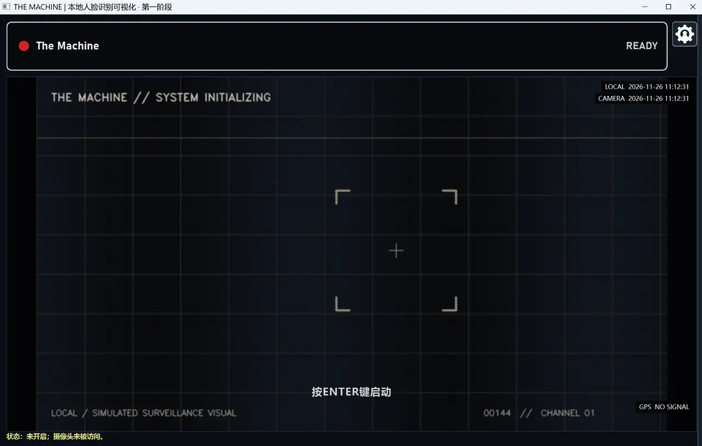
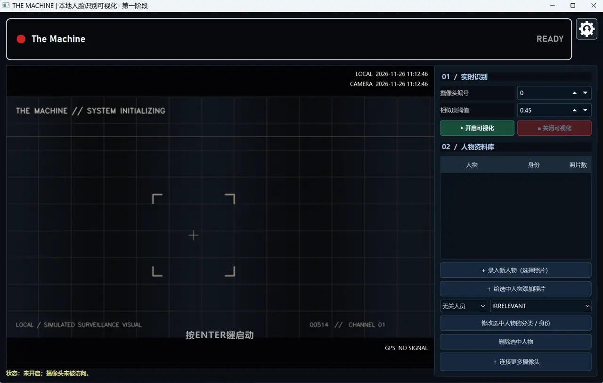

# THE MACHINE OF POI

**《疑犯追踪》（Person of Interest）风格的本地人脸识别可视化程序**  
**A local face-recognition visualizer inspired by *Person of Interest*.**

  [](https://github.com/along-126/The-Machine-of-POI/actions/workflows/python-tests.yml) [](https://github.com/along-126/The-Machine-of-POI/releases) 

> **非官方粉丝项目 / Unofficial fan project**  
> 本项目借鉴电视剧中 The Machine 的视觉风格，不隶属于或代表电视剧版权方。它是独立的人脸识别**可视化**工具，不参与 Windows Hello 身份验证，也不负责解锁电脑。  
> This project takes visual inspiration from The Machine in *the Person of Interest*. It is not affiliated with the show's rights holders. It is a standalone **visualization** application—not a Windows Hello authentication or unlock tool.

**语言 / Languages：** [简体中文](#简体中文) · [English](#english)

**当前版本 / Releases：** [v1.0.0](https://github.com/along-126/The-Machine-of-POI/releases/tag/v1.0.0) 已发布；**v1.1.0 界面改版正在准备中，尚未发布。**  
**Version status:** [v1.0.0](https://github.com/along-126/The-Machine-of-POI/releases/tag/v1.0.0) is published; the **v1.1.0 UI redesign is in preparation and is not released yet.**

---

## 简体中文

### 项目简介

The Machine of POI 是一款使用 **Python、PySide6 和 OpenCV** 开发的 Windows 11 桌面程序，重点复刻《疑犯追踪》中人脸被识别框锁定、分类的视觉效果。

程序通过本地摄像头或用户主动连接的授权视频源获取画面，在**本机**检测人脸、提取特征、匹配已录入人物，并绘制跟随人脸移动的 HUD 识别框。人脸识别的计算过程不调用云端 API。

## Screenshots / 软件截图

以下截图来自当前 Windows 11 版本，展示待启动画面、动态侧边控制栏和实时人脸识别效果。  
The following screenshots show the current Windows 11 UI: standby mode, the sliding control panel, and live face tracking.

### 1. READY 待启动界面 / READY standby



完成启动加载后显示 `READY` 和“按ENTER键启动”，摄像头此时尚未启用。  
After the boot sequence, `READY` appears; the camera remains off until started by the user.

### 2. 动态侧边栏 / Sliding control panel



鼠标移到右侧边缘即可展开控制栏，可设置摄像头编号、管理人物资料，按 **F2** 锁定或取消锁定面板。  
Hover near the right edge to reveal camera controls and the people database; press **F2** to pin or unpin the panel.

### 3. 实时人脸识别 / Live face tracking


启动摄像头后，识别框跟随画面中的人脸，展示用户配置的人物标签。本示例已遮挡主要人脸，避免公开可识别的个人面部信息。  
After starting the camera, the HUD tracks faces and shows user-assigned labels. The main face in this demonstration is covered for privacy.

> **隐私提示 / Privacy:** 截图可能含有背景人物或场景信息；上传新的截图前，请确认已获得必要授权并检查隐私内容。 / Screenshots may contain bystanders or location details; check permission and privacy before publishing new screenshots.

### 已实现的功能

- **实时检测与跟踪：** 检测画面中的一张或多张人脸，跟随移动绘制识别框。
- **人物资料库：** 从单人照片录入人物，可为同一人物添加多张照片、调整分类或删除人物；人物信息与人脸特征保存在本地 SQLite 数据库。
- **七种 HUD 样式：** 包括不同的边框主体、角标、准线、霓虹效果以及身份文字标签。
- **多种视频来源：** 支持 Windows 摄像头；支持用户主动添加经过授权的 RTSP / HTTP(S) 直接视频流（实际可用性取决于编码和服务端）。已对本地 HTTP/MJPEG 测试流进行过验证。
- **可配置画面信息：** 显示本地时间、摄像头所在地时间及经纬度；可点击字段修改、隐藏。无法获得可靠信息时显示 `NO SIGNAL`。
- **主动控制：** 用户可以开启或关闭摄像头可视化；关闭时程序释放摄像头资源。
- **启动流程：** 启动时显示 `PROCESSING...` 和进度条，随后进入淡入淡出的 `READY` 状态；按 **Enter** 启动设置中的默认本地摄像头，也可在侧边控制栏手动启动。
- **待启动动画：** 默认展示程序原创的监控风格循环画面；可关闭动画，或选取有权使用的**本地视频**作为待启动画面。此功能不等于支持将本地视频作为识别输入。
- **动态侧边栏：** 将鼠标移至窗口右边缘展开，移开后自动收起；按 **F2** 可以固定或取消固定侧边栏。
- **界面设置：** 右上角设置图标可调整默认摄像头编号、待启动动画及本地启动视频，并查看 HUD“边框说明”；右键点击启动进度条或状态文字可调整加载时长。

**当前限制：** 同一时间只显示**一路**视频；切换视频源不等于同时监控多路摄像头。蓝牙配对不保证能获得视频流，尚未实现任意蓝牙摄像头视频协议。网络视频源必须由用户主动连接，且需要网络；本地摄像头模式在安装完成后可离线运行。

### 人物分类

| HUD 样式 | 身份标签 | 文字效果 |
| --- | --- | --- |
| 白色边框 | `IRRELEVANT` | 白底黑字 |
| 红色边框 | `THREAT` | 红底白字 |
| 黄色边框 | `ADMIN` / `PRIMARY ASSET` / `SECONDARY ASSET` / `CONTINGENCY` | 黄底黑字 |
| 蓝色边框 | `ASSET CATALYST` | 蓝底黑字 |
| 黑色边框 + 黄色角标和准线 | `ANALOG INTERFACE` / `ROOT` | 黑底黄字 |
| 蓝色边框 + 白色角标和准线 | `RELEVANT-ONE` / `RELEVANT-TWO` / `RELEVANT-THREE` / `RELEVANT-OTHER` | 蓝底白字 |
| 白色边框 + 红色角标和准线 | `IRRELEVANT THREAT` | 白底红字 |

未录入人物默认显示 `IRRELEVANT`。新增人物的默认标签为 `ADMIN`；每名人物同时只设置一个身份标签。所有分类名称均为**用户指定的视觉标签**，不表示软件能够判断人物的真实威胁性、身份或社会角色。

### 安装与启动

**系统要求：** Windows 11、Python **3.14（64 位）**、可用的摄像头（如需本地视频识别）。首次安装 Python 依赖和模型时需要联网。

1. 在 GitHub 仓库页面选择 **Code → Download ZIP**，解压到一个文件夹（或使用 Git 克隆仓库）。
2. 安装 Python 3.14（64 位）。在终端执行 `py -3.14 --version`，确认安装成功。
3. 双击 **`01_install_environment.bat`**：创建 `.venv` 虚拟环境并安装依赖。
4. 双击 **`02_download_models.bat`**：下载并校验 YuNet 人脸检测模型与 SFace 人脸识别模型。
5. 双击 **`03_run.bat`**：等待 `PROCESSING...` 变为 `READY`；按 **Enter** 启动默认摄像头，或将鼠标移至窗口右边缘展开控制栏后使用启动按钮。

首次安装后，依赖位于 `.venv/`，模型位于 `models/`，本地数据库及设置位于 `data/`。这些运行时文件**不包含在 GitHub 仓库中**，由用户在自己的电脑上生成。

### 使用提示

- **启动快捷键：** 进入 `READY` 状态后按 **Enter** 启动默认本地摄像头；在文本输入框或对话框中操作时，Enter 不会触发摄像头启动。
- **动态侧边栏：** 将鼠标移至窗口右边缘展开控制栏；按 **F2** 固定或取消固定，离开后可自动收起。
- **设置界面：** 点击右上角的白色设置图标，选择默认摄像头（编号 0–20）、待启动动画、本地启动视频或“边框说明”。右键点击 `PROCESSING...` / `READY` 状态文字或进度条可修改加载时长。
- **录入人物：** 在右侧人物资料库添加人物、选择单人照片，并为其选择身份标签。照片应得到当事人许可。
- **切换分类：** 选中人物后选择分类和身份文字，点击修改。
- **连接网络视频：** 点击“连接更多摄像头”，输入获授权的**直接视频流地址**，确认后再连接。普通网页播放器链接不一定能被程序读取。
- **调整时间与位置：** 点击画面右上角的时间字段或右下角的坐标字段。远程摄像头的时间/位置通常需要用户提供；程序不会仅靠画面自动确定 GPS 坐标。
- **本地 MJPEG 测试：** 项目提供 `04_START_LOCAL_TEST_STREAM.bat` 和 `05_test_local_mjpeg.bat` 供排查网络视频读取问题；它们不是程序日常运行所必需的步骤。

### 隐私、安全与使用边界

- 人脸检测、特征提取和身份匹配均在本机进行；**不会自动上传摄像头画面或人脸特征**。
- `data/machine.db` 包含生物识别特征，**当前未加密**，请保护好该文件、系统账户和备份。`data/settings.json` 可能包含视频源地址，也应留在本机、不上传公开仓库。
- 只有用户主动连接远程视频源时才会访问网络；视频流本身仍会经过网络传输。
- 识别存在误判风险，不能用于身份认证、执法结论、风险判定或其他高风险决策。
- 仅在有权访问视频源、取得必要许可并遵守适用法律和平台条款的情况下使用；不要用它识别未经同意的陌生人或进行不当监控。

### 自动化测试

GitHub Actions 在针对 `main` 的 Push 和 Pull Request 时自动运行：在 Windows / Python 3.14 上安装依赖、检查语法，并使用 pytest 测试 `tests/` 里的核心逻辑。可点击顶部 **Python tests** 徽章查看状态。

这些测试覆盖选定的数据库、人物分类、人脸追踪及 HUD 绘制逻辑，**不能代替真实摄像头、模型及完整 GUI 在 Windows 上的人工测试**。

在已完成依赖安装的本地环境中，可运行：

```powershell
.venv\Scripts\python.exe -m pip install pytest
.venv\Scripts\python.exe -m pytest -q tests/
```

### 项目结构（主要文件）

```text
The-Machine-of-POI/
├── main.py                      # 主界面与摄像头控制
├── face_engine.py               # YuNet / SFace 检测与匹配
├── tracking.py                  # 人脸跟踪
├── hud.py                       # HUD 绘制
├── classifications.py           # 分类与身份标签
├── database.py                  # SQLite 人物资料库
├── metadata.py                  # 时间与坐标显示
├── camera_sources.py            # 视频流地址校验
├── mjpeg_capture.py             # HTTP/MJPEG 视频读取
├── download_models.py           # 下载并校验模型
├── standby.py                  # 原创待启动动态画面
├── ui_effects.py               # READY 淡入淡出计算
├── .github/workflows/          # GitHub Actions 自动化测试
├── requirements.txt             # Python 依赖
├── 01_install_environment.bat
├── 02_download_models.bat
├── 03_run.bat
└── tests/                       # 自动化测试
```

### 发布准备与后续计划

- **v1.1.0 发行准备中：** 需进一步核对最新界面、安装步骤、截图与 Windows 实机运行结果，然后再创建正式 Release。
- 优化网络摄像头连接状态、超时诊断和断线重连。
- 增加本地视频文件导入与播放。
- 研究多路摄像头同时显示及性能控制。
- 继续打磨识别框动画、扫描效果与界面细节。
- 进行纯英文版本的开发。

---

## English

### Overview

**The Machine of POI** is an experimental Windows 11 desktop application built with **Python, PySide6, and OpenCV**. It recreates the face-tracking and classification HUD aesthetic inspired by *Person of Interest*.

It reads video from a local camera or a user-authorized stream, detects and tracks faces, compares embeddings with a local SQLite database, and overlays a classification HUD. **Face processing and matching run locally**, without a cloud recognition service.

### Features

- Real-time face detection and tracking, including multiple faces in one frame.
- Local person database with photo enrollment, multiple samples per person, and editable labels.
- Seven HUD designs and **14 available identity labels**, including the single blue label **`ASSET CATALYST`**.
- Windows camera input; user-initiated, authorized RTSP / HTTP(S) direct video streams. Compatibility varies by codec and provider. Local HTTP/MJPEG streaming has been tested.
- Clickable local/camera time and coordinate overlays, with `NO SIGNAL` when reliable metadata is unavailable.
- User-controlled start/stop and offline face recognition after initial dependency/model setup.
- Redesigned boot flow: `PROCESSING...` with a progress bar becomes gently pulsing `READY`. Press **Enter** to start the configured default local camera, or use the control-panel start button.
- Built-in original animated standby display, optionally disabled or replaced with a user-authorized **local standby video**. This is **not** the same as local video-file input for recognition.
- Sliding side panel: hover at the right edge to expand, move away to auto-collapse, and press **F2** to pin/unpin.
- Top-right settings: select the default camera index, standby animation, local standby video and HUD label legend; right-click the boot status/progress controls to adjust the startup duration.

**Current limitations:** One video source is displayed at a time. Generic Bluetooth video-camera integration, simultaneous multi-camera grids, and Windows Hello integration are **not** implemented. Some HLS/RTSP streams may not be decodable by the installed backend.

### Getting started

**Requirements:** Windows 11 and **Python 3.14 (64-bit)**. An accessible camera is needed for local live video. Internet access is required for first-time dependency and model downloads.

1. Use **Code → Download ZIP** on GitHub (or clone the repository), then extract it.
2. Verify Python with `py -3.14 --version`.
3. Run **`01_install_environment.bat`** to set up the isolated environment.
4. Run **`02_download_models.bat`** to download and verify the YuNet and SFace model files.
5. Run **`03_run.bat`**. Wait for `PROCESSING...` to change to `READY`, then press **Enter** to start the default local camera; alternatively, hover at the right edge and use the control panel's start button.

The application creates local runtime directories such as `.venv/`, `models/`, and `data/` as needed; their contents are intentionally excluded from version control.

### Interface and controls

- **Enter:** Start the configured local camera from the `READY` state, except while editing fields or interacting with dialog controls.
- **Right-edge hover / F2:** Show the camera and people control panel / pin or unpin the panel.
- **Settings icon:** Configure the default camera index (0–20), standby animation and optional local standby video; open the HUD legend.
- **Boot status / progress right-click:** Adjust the startup progress duration.
- **Connect more cameras:** Use the control panel to add user-authorized RTSP / HTTP(S) direct streams.

### Privacy and responsible use

- Face embeddings and person labels are stored in the local SQLite database (`data/machine.db`); **the database is not encrypted**. Settings in `data/settings.json` may also contain private stream URLs and must not be published.
- Face detection and matching do not upload images or embeddings. User-initiated remote streams inherently require network connectivity.
- Classifications such as `THREAT` are **manual visual labels**, not automated threat assessments.
- Results can be inaccurate. Do not use this project for authentication, law enforcement decisions, or other high-stakes determinations.
- Use only cameras and images that you are authorized to access and process, with appropriate consent and in compliance with applicable law.

### Automated tests

GitHub Actions runs on pushes to `main` and pull requests targeting `main`. It installs dependencies on Windows / Python 3.14, checks syntax, and runs the offline `tests/` pytest suite. See the **Python tests** badge above. The suite covers selected core logic but **does not replace manual Windows verification of the camera, recognition models and full GUI**.

To run the tests in an already configured local environment:

```powershell
.venv\Scripts\python.exe -m pip install pytest
.venv\Scripts\python.exe -m pytest -q tests/
```

### Release preparation and roadmap

**v1.0.0** is published; **v1.1.0** is in preparation, pending a final check of the UI, screenshots, installation steps and real Windows operation. Planned improvements include local video-file import, more reliable network-stream handling and diagnostics, optional multi-camera views, and smoother HUD animations. Windows Hello integration is **not part of the current implementation**.

---

## Technology / 技术栈

Python 3.14 · PySide6 · OpenCV · NumPy · SQLite · OpenCV Zoo YuNet / SFace · HTTP/MJPEG

## License / 开源许可证

This project's original source code is licensed under the MIT License. See [LICENSE](LICENSE) for details.

本项目的原创源代码采用 MIT 开源许可证，详情请参阅 [LICENSE](LICENSE)。

Third-party libraries, models, and other materials remain subject to their respective licenses.

第三方依赖库、人脸识别模型及其他素材仍遵循各自的许可证。

## Credits & legal / 致谢与声明

- Design inspiration: *the Person of Interest* / The Machine. All related names, marks and television imagery belong to their respective rights holders.
- Face models: OpenCV Zoo **YuNet** and **SFace**. Third-party libraries and model weights remain subject to their respective licenses and notices.
- This is an **unofficial, non-affiliated fan project**.

